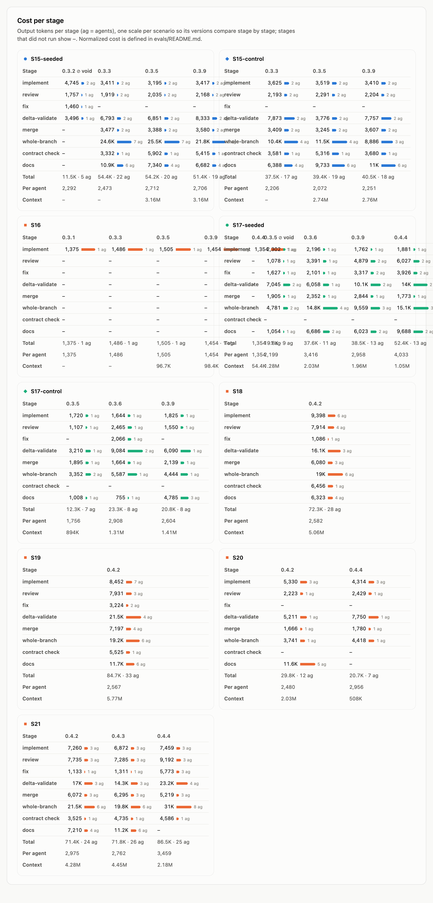

# hydra

A Claude Code plugin with one skill, `/hydra:run`: a multi-repo, multi-agent implementation workflow.

<!-- eval:start -->
**Combined score:** 99/100 (9 of 9 scenarios)

**Latest eval:** S15-seeded 0.3.9 pass (recall 9/10) · S15-control 0.3.9 pass (0 major false positives) · S16 0.4.4 pass (honest) · S17-seeded 0.4.4 pass (recall 4/4) · S17-control 0.3.9 pass (0 major false positives) · S18 0.4.2 pass (all 4 criteria hold) · S19 0.4.2 pass (all 3 criteria hold) · S20 0.4.4 pass (all 3 criteria hold) · S21 0.4.4 pass (all 3 criteria hold)

One run per scenario on a small fixture; limits in evals/retros/.


<details><summary>More charts</summary>




</details>

Interactive report: [evals/report.html](evals/report.html), open locally (GitHub shows source).
<!-- eval:end -->

- One feature branch per repo. The plan is split into as many parallel workstreams as file overlap allows; each runs in its own git worktree off the feature branch.
- Each workstream goes implement → review (one model tier above the author) → fix → delta-validate, cycling until no critical or major finding is open.
- A finding that only a brief change can settle (the brief contradicts itself or the repo, or a fix would undo an earlier verified fix) becomes a question for the user, never a fix.
- Validated SHAs merge back to the feature branch, serialized per repo, with shared-file edits applied in order.
- Then a whole-branch review plus an independent validator, a cross-repo contract check, and a validated docs sync. A repo whose only workstream merged onto its untouched base has no seam to review, so only the validator runs there.
- Whole-branch fix rounds stop on churn: two rounds in a row that each bring a new regression-kind blocker in a file the round's fixer was asked to fix stop that repo's rounds with a question. Rounds that run out on a green recheck with no open critical, regression or integration finding offer to promote the checked head with its open majors parked as known gaps; the offer is skipped when `acceptance` or `stopRule` is set.
- A fixer whose only fix lies outside its workstream's `files[]` hands the finding to the whole-branch pass, where it stops counting toward that workstream's cycles. Every gate runs through one pipefail wrapper that prints its exit code last, and a step whose agent died twice gets a health probe before a third try.
- A `carried` claim (the only fix lies outside `files[]`) is checked by the validator; a rejected claim goes back to the fixer for one more cycle, counted by the usual stop rules. A soft block that continued on its defaults reads `status: done`, with a note. An infra stop says how many times the agent actually died and that the step can be resumed. Unconfirmed drift-audit items are kept under `drift.unconfirmed`, with no question.
- With a progress panel, the coordinator sends a progress call at every return, the review phase and dropped workstreams included. The coordinator also runs each merged workstream's `checks` once itself at `finalSha`.
- Smaller prompt fixes: the churn question no longer repeats the repo name, the decision-log sentence is emitted only with `decisionLog`, a regression under a stop rule has one meaning (it worked at the base or before a fix in this run), the drift prompt opens with its task and says what to do with an unreadable log, and the whole-branch fixer lists each file it changed as `changed: <path>` in notes.
- The mechanical part lives in `skills/run/workflow.js` (a Claude Code Workflow script); `skills/run/SKILL.md` is the coordinator's procedure.

Opt-in, per run (details and every arg in `skills/run/SKILL.md`):

- `localOnly: true`: nothing reaches the network. Every push, fetch and `ls-remote` targets a bare repo on local disk set up as the remote `hydra-local`; the branches are fetched back into your repo as local branches at the end, and pushing stays yours.
- `workstreams[].after: [ids]`: a workstream starts only once those (same repo) merged, and branches from that head.
- `workstreams[].lite: true`: for small pure files, implement plus one validator and no review cycles unless it finds a critical or major.
- `workstreams[].humanCheck`: once that workstream merges, its repo's whole-branch pass waits and the run returns what to check by eye, every check of a repo in one pause; a re-run with `resumeFromRunId`, `resume` and `humanChecks` (each answer bound to the workstream's own head, so a re-merge with no new commit keeps it) continues, and a reported problem goes back to its author.
- `workstreams[].checks` / `workstreams[].knownRedChecks`: each check's exit code comes back typed in `checkExits`. The script rates the validators' exits: a red or timed-out check that is not known-red turns the gate red (critical), and is never rerun. A validator's red where the author reported 0 is labelled a false green. The whole-branch validator and each recheck re-run the checks of every merged workstream on the merged tip. `knownRedChecks` lists entries of `checks` that are red at the base: their exit is reported, never a finding.
- `resume` (on every `resumeFromRunId` call): a live git probe rebuilds each workstream's state before any stage, so merged workstreams are carried, a dead agent's workstream re-runs live, and no whole-branch pass reports `pass` while a planned workstream is unmerged. The resumed result's `carryForward` goes back with it, so handed and shared-edits findings, settled ledgers and passed whole-branch passes survive the resume.
- `decisions`: the user's answer to a blocked workstream's question, on a resume; that same workstream resumes at implement with the answer in its brief.
- `dropped`: workstream ids the user dropped. They run no agent, the rest merges, and the result lists them as not done (top-level `dropped`, the repo note `not done (dropped): <ids>`) for the PR body's Not done list. The stuck-finding question names this re-run.
- `workstreams[].files` may overlap another workstream's when one is ordered `after` the other.
- `stepTool: "<tool name>"`: workers report their steps with that tool, and send `failed` only when their own attempt at a step failed. Hydra never hard-codes a tool name.
- `repos[].copyExcluded`: git-ignored files the gate needs (a local preview test) are copied into every agent worktree and never committed.
- `repos[].reviewSharedEdits: true`: the shared-file edits each merge applies get their own gate and validator before the next merge.
- `repos[].commitPrefix`: optional non-empty string with no newline or quote, put before the merge step's fixed subjects (shared-file edits, regenerated files) and the docs step's graph refresh; the merge commit subject is unchanged.
- A gate must not pipe into `head` or `grep -q` (SIGPIPE, exit 141); the script rejects both.
- `stopRule` + `acceptance`: a string of wrong actions and an approved case table; reviewers block only on those and on regressions vs the base, validators run each row black-box.
- `decisionLog`: the user's answers become binding for every agent, and a read-only drift audit after the run turns each unlogged change into a revert-by-default question.
- `wbReviewModel`: pick the integrated whole-branch review model (cheaper on intermediate passes, top tier on the pass expected to close clean).

Stacked PRs are an opt-in mode, used only when asked for.

## Install

```
/plugin marketplace add nycom/hydra
/plugin install hydra@hydra
```

Expects `implementer`, `reviewer` and `validator` subagents in `~/.claude/agents/`.

Optional, for per-worker step bars in a progress mod that offers a step tool: add that tool to the `tools:` list of the implementer, reviewer and validator agent types, then pass `stepTool` (see `SKILL.md`).

## Tests

```
(cd skills/run/tests && for f in check*.mjs; do node $f ../workflow.js; done)
node skills/run/tests/run-cmd.test.mjs
python3 skills/run/stale_sweep.py --self-test
```

The eval report has its own check, which fails when `evals/report.html`, the README eval block, `evals/report.sha256` or a PNG under `evals/png/` is stale against `evals/runs/`. After changing a run file or `evals/report.mjs`, refresh them (and the PNGs) with the snapshot step, which needs Google Chrome:

```
evals/snapshot.sh
node evals/report.test.mjs
```

The report also scores the pass/fail scenarios S18-S21 through a run's `flow` criteria, and the fixture builder (`skills/run/tests/fixture/build.sh`) has a `--flow` mode.

Run schema and details: [evals/README.md](evals/README.md).

Formerly a private skill called `delegate`.
