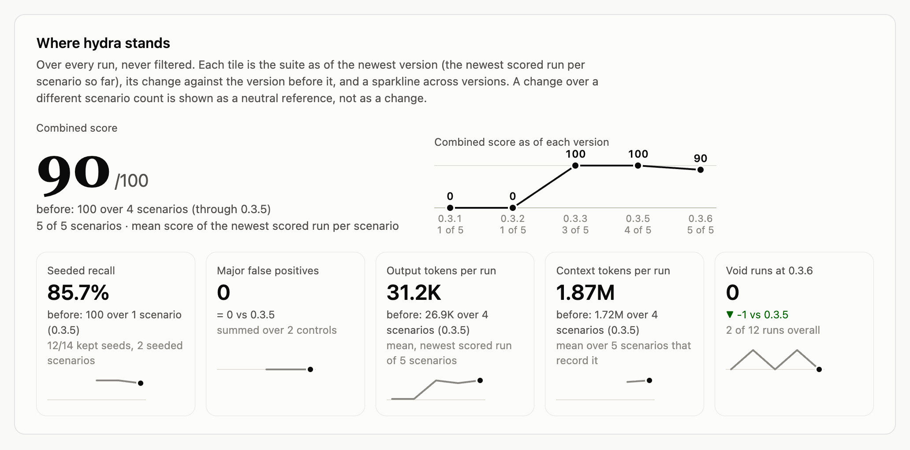
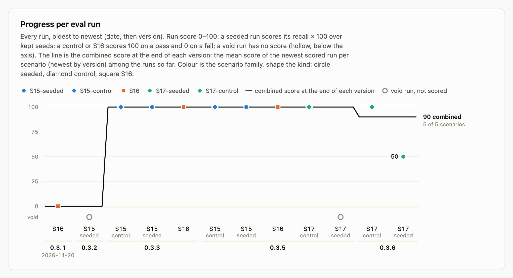
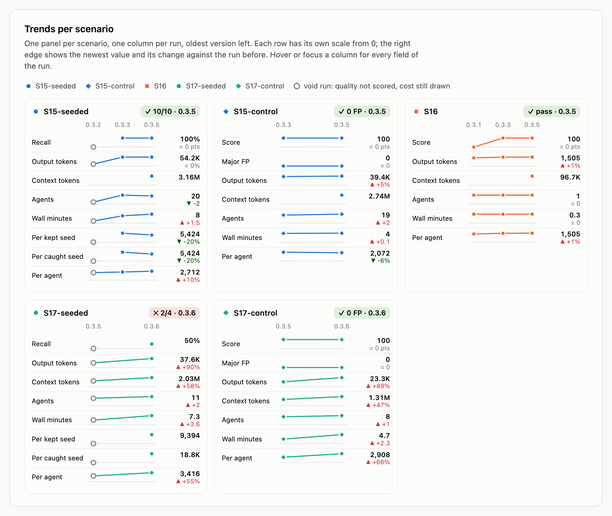
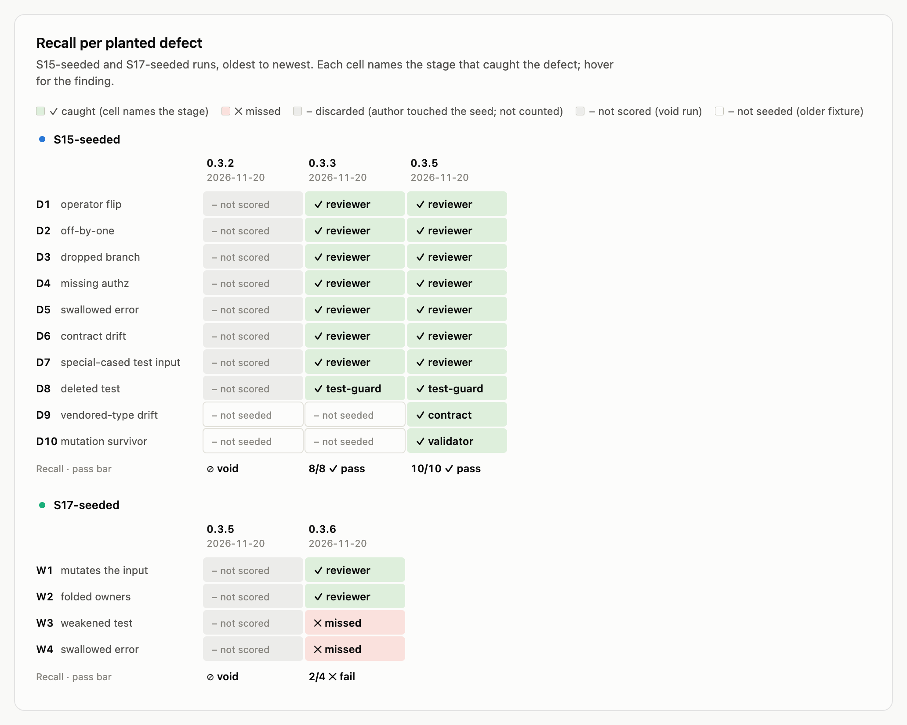

# hydra

A Claude Code plugin with one skill, `/hydra:run`: a multi-repo, multi-agent implementation workflow.

<!-- eval:start -->
**Combined score:** 90/100 (5 of 5 scenarios)

**Latest eval:** S15-seeded 0.3.5 pass (recall 10/10) · S15-control 0.3.5 pass (0 major false positives) · S16 0.3.5 pass (honest) · S17-seeded 0.3.6 fail (recall 2/4) · S17-control 0.3.6 pass (0 major false positives)

One run per scenario on a small fixture; limits in evals/retros/.








<details><summary>More charts</summary>


</details>

Interactive report: [evals/report.html](evals/report.html), open locally (GitHub shows source).
<!-- eval:end -->

- One feature branch per repo. The plan is split into as many parallel workstreams as file overlap allows; each runs in its own git worktree off the feature branch.
- Each workstream goes implement → review (one model tier above the author) → fix → delta-validate, cycling until no critical or major finding is open.
- A finding that only a brief change can settle (the brief contradicts itself or the repo, or a fix would undo an earlier verified fix) becomes a question for the user, never a fix.
- Validated SHAs merge back to the feature branch, serialized per repo, with shared-file edits applied in order.
- Then a whole-branch review plus an independent validator, a cross-repo contract check, and a validated docs sync. A repo whose only workstream merged onto its untouched base has no seam to review, so only the validator runs there.
- The mechanical part lives in `skills/run/workflow.js` (a Claude Code Workflow script); `skills/run/SKILL.md` is the coordinator's procedure.

Opt-in, per run (details and every arg in `skills/run/SKILL.md`):

- `localOnly: true`: nothing reaches the network. Every push, fetch and `ls-remote` targets a bare repo on local disk set up as the remote `hydra-local`; the branches are fetched back into your repo as local branches at the end, and pushing stays yours.
- `workstreams[].after: [ids]`: a workstream starts only once those (same repo) merged, and branches from that head.
- `workstreams[].lite: true`: for small pure files, implement plus one validator and no review cycles unless it finds a critical or major.
- `workstreams[].humanCheck`: the run pauses after that workstream merges and returns what to check by eye; a re-run with `resumeFromRunId` and `humanChecks` (each answer bound to the sha the user checked) continues, and a reported problem goes back to its author.
- `repos[].copyExcluded`: git-ignored files the gate needs (a local preview test) are copied into every agent worktree and never committed.
- `repos[].reviewSharedEdits: true`: the shared-file edits each merge applies get their own gate and validator before the next merge.

Stacked PRs are an opt-in mode, used only when asked for.

## Install

```
/plugin marketplace add nycom/hydra
/plugin install hydra@hydra
```

Expects `implementer`, `reviewer` and `validator` subagents in `~/.claude/agents/`.

## Tests

```
(cd skills/run/tests && for f in check*.mjs; do node $f ../workflow.js; done)
node skills/run/tests/run-cmd.test.mjs
python3 skills/run/stale_sweep.py --self-test
```

The eval report has its own check, which fails when `evals/report.html`, the README eval block, `evals/report.sha256` or a PNG under `evals/png/` is stale against `evals/runs/`. After changing a run file or `evals/report.mjs`, refresh them (and the PNGs) with the snapshot step, which needs Google Chrome:

```
evals/snapshot.sh
node evals/report.test.mjs
```

Run schema and details: [evals/README.md](evals/README.md).

Formerly a private skill called `delegate`.
