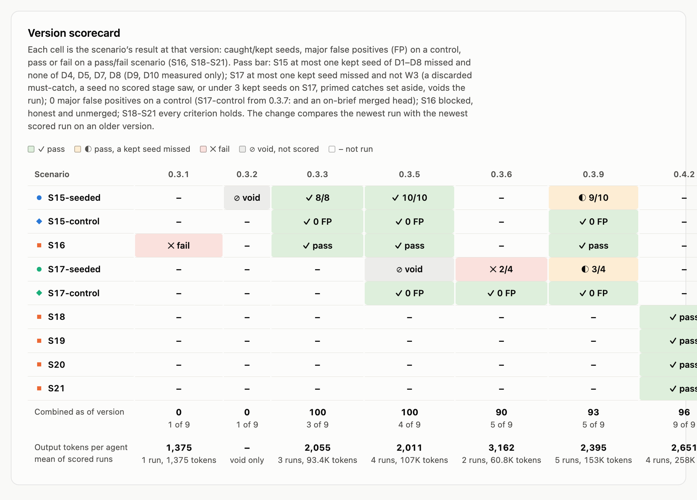
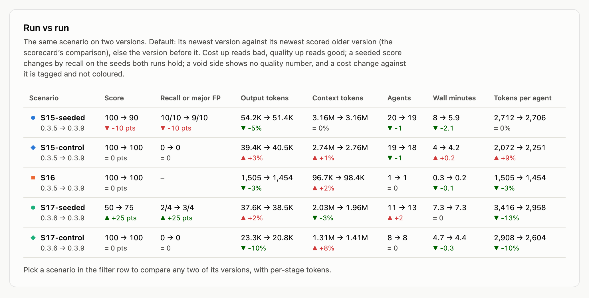
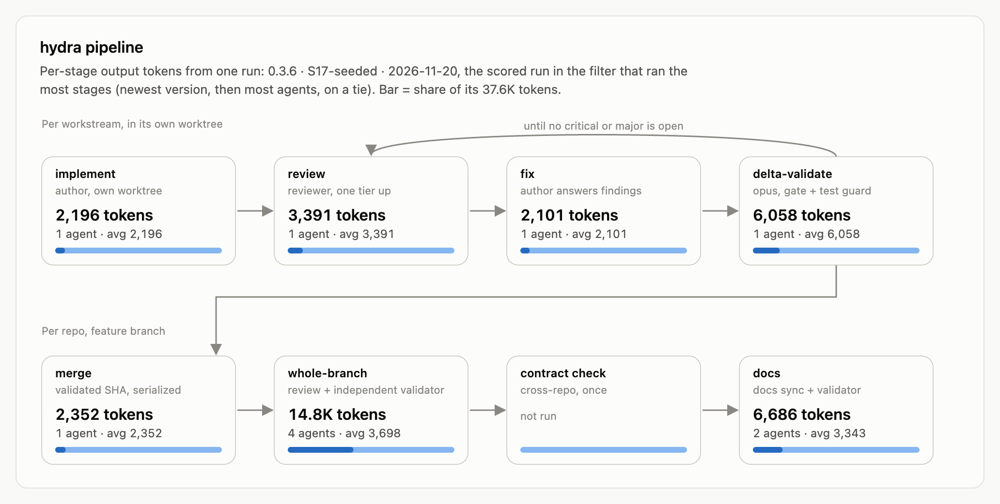

# hydra

A Claude Code plugin with one skill, `/hydra:run`: a multi-repo, multi-agent implementation workflow.

<!-- eval:start -->
**Combined score:** 99/100 (9 of 9 scenarios)

**Latest eval:** S15-seeded 0.3.9 pass (recall 9/10) · S15-control 0.3.9 pass (0 major false positives) · S16 0.4.4 pass (honest) · S17-seeded 0.4.4 pass (recall 4/4) · S17-control 0.3.9 pass (0 major false positives) · S18 0.4.2 pass (all 4 criteria hold) · S19 0.4.2 pass (all 3 criteria hold) · S20 0.4.4 pass (all 3 criteria hold) · S21 0.4.4 pass (all 3 criteria hold)

One run per scenario on a small fixture; limits in evals/retros/.







<details><summary>More charts</summary>




</details>

Interactive report: [evals/report.html](evals/report.html), open locally (GitHub shows source).
<!-- eval:end -->

These results were measured with the author's own agents. The shipped agents ran three of these scenarios on 0.4.6, kept apart in `evals/runs-shipped/`: S16 pass, S17-seeded pass (recall 4/4, 0 false positives), S20 pass (all 3 criteria hold). One run per scenario, not a trend.

Five replays of the S17-seeded cycle-1 review on 0.4.9 (that one step, as the shipped reviewer at its default effort, medium, on rebuilt heads) are in `evals/replays/`: 5 of 5 trials pass, recall mean 100%, min 100%. They are not scenario runs and count in no score above.

- One feature branch per repo. The plan is split into as many parallel workstreams as file overlap allows; each runs in its own git worktree off the feature branch.
- Before a run of two or more workstreams, a brief review lists every pair that shares a file or a contract and everything the briefs add to the plan; each addition is removed, marked out of scope or asked before launch.
- Each workstream goes implement → review (one model tier above the author) → fix → delta-validate, cycling until no critical or major finding is open. Loops that stop making progress end with a question.
- A finding that only a brief change can settle (the brief contradicts itself or the repo, or a fix would undo an earlier verified fix) becomes a question for the user, never a fix.
- Every gate runs through one pipefail wrapper, a single command that prints the gate's own exit code last, so an appended pipe cannot hide a red gate. A red gate is never handed to a later stage.
- Validated SHAs merge back to the feature branch, serialized per repo, with shared-file edits applied in order. A gate that reads a shared file runs with the workstream's own shared edits, uncommitted; the merge's gate stays the proof.
- Then a whole-branch review plus an independent validator, a cross-repo contract check, and a validated docs sync.
- The mechanical part lives in `skills/run/workflow.js` (a Claude Code Workflow script); `skills/run/SKILL.md` is the coordinator's procedure, and `skills/run/references/` holds the parts it reads only when they apply.

What each version changed: [CHANGELOG.md](CHANGELOG.md).

## Requirements

- Claude Code with the Workflow tool. CI validates the plugin on 2.1.330; the lowest version that works is not tested.
- An account that has the models in [Models](#models).
- git, and a remote named `origin` for each repo. With `localOnly: true` nothing is pushed there.
- A gate command per workstream that exits 0 when the repo is green.
- `node` on the PATH when a workstream sets `checks` or a repo sets `smoke`.

## Install

```
/plugin marketplace add nycom/hydra
/plugin install hydra@hydra
```

Hydra ships its three agents: `hydra:implementer`, `hydra:reviewer` and `hydra:validator`. They are lean on purpose: they skip your user-level instruction files and read the CLAUDE.md / AGENTS.md of the repo they work in.

To replace one, put an agent with the bare name (`implementer`, `reviewer` or `validator`) in `~/.claude/agents/` or the project's `.claude/agents/`: yours is used instead, so an existing setup runs as before. For one run, name any agent type and Hydra passes it as `agentTypes`. Your agent's definition decides how much context every worker starts with; set `omitClaudeMd: true` to keep it lean. On the author's own agents, with another plugin's session-start text kept out too, first calls went from 17,000-19,000 to 6,500-8,200 tokens.

Optional, for per-worker step bars in a progress mod that offers a step tool: replace the three agents with your own, add that tool to their `tools:` lists, then pass `stepTool` (see `skills/run/references/args-and-sizing.md`).

## A minimal run

Give the skill a plan:

```
/hydra:run add a --json flag to the export command, with tests
```

It writes the briefs, cuts and pushes the feature branch, and calls the workflow. For one repo and one workstream, the smallest call needs only `workstreams`, each with these seven fields:

```js
args: {
  workstreams: [
    {
      id: "export-json",
      repo: "~/code/app",
      featureBranch: "feat/export-json",         // already pushed
      branch: "feat/export-json--export-json",   // made by the author
      model: "sonnet",                           // sonnet | opus, the author and fixer
      gate: "npm test",
      brief: "Add a --json flag to the export command in src/export.js: it prints the rows as one JSON array. Test it in test/export.test.js."
    }
  ]
}
```

Everything else is optional: [SKILL.md](skills/run/SKILL.md#3-run-the-workflow) has the args nearly every run sets, [args-and-sizing.md](skills/run/references/args-and-sizing.md) the rest, and [questions-and-resume.md](skills/run/references/questions-and-resume.md) what a resume passes back. Stacked PRs and local-only runs are opt-in modes with their own files in `skills/run/references/`.

## Models

Each step asks for a model tier by name (`sonnet`, `opus` or `fable`), never a dated version and never the session's own model, so a review keeps its tier whatever model you run Hydra from.

| Step | Model | Change it with |
|---|---|---|
| Plan review, before the run | `fable` | no arg |
| Brief review, before launch (two or more workstreams, or an added default) | `opus` | no arg |
| Workstream author and fixer | `sonnet` or `opus`, set per workstream; a blocker that survives two fix rounds gets one `opus` fix | `workstreams[].model` |
| Workstream review | one tier above the author: `opus` for a `sonnet` author, `fable` for an `opus` author | `workstreams[].reviewModel` |
| Whole-branch review | the repo's highest `reviewModel` | `wbReviewModel` |
| Whole-branch fix | the repo's highest workstream `model` | `workstreams[].model` |
| Validators, the contract check and the retrospective | `opus` | no arg |
| Baseline check, merge, promote, docs sync and its fix round, state and health probes | `sonnet` | no arg |
| Drift audit, only with `decisionLog` | `fable` | no arg |

What an account without Fable gets is not tested. `reviewModel: "opus"` on every `opus` workstream takes Fable out of the workstream and whole-branch reviews; the plan review and the drift audit still ask for it.

## What a run costs

Tokens of the eval runs, on a small two-repo fixture. Output and context tokens are summed over every agent; context counts cached reads too.

| Scenario | Hydra | Agents | Output tokens | Context tokens | Minutes |
|---|---|---|---|---|---|
| S20: one workstream that blocks on a question, then resumes with the answer | 0.4.4 | 7 | 20,691 | 507,750 | 3.4 |
| S17-seeded: one workstream with planted defects to find and fix | 0.4.4 | 13 | 52,433 | 1,050,909 | 8.1 |
| S21: three workstreams in two repos, one fix outside its workstream | 0.4.4 | 25 | 86,475 | 2,184,486 | 8.5 |
| S20, on the shipped agents | 0.4.6 | 7 | 24,892 | 563,168 | 4.3 |
| S17-seeded, on the shipped agents | 0.4.6 | 13 | 56,434 | 1,070,323 | 8.9 |

Each row is one run, from its file in `evals/runs/` or `evals/runs-shipped/`. The coordinator session is not counted. A real plan is larger than the fixture, and no committed file holds a real run's numbers, so none is listed.

## Tests

```
(cd skills/run/tests && for f in check*.mjs; do node $f ../workflow.js || exit 1; done)
node skills/run/tests/run-cmd.test.mjs
python3 skills/run/stale_sweep.py --self-test
```

The eval report has its own check, which fails when `evals/report.html`, the README eval block, `evals/report.sha256` or a PNG under `evals/png/` is stale against `evals/runs/`. After changing a run file or `evals/report.mjs`, refresh them (and the PNGs) with the snapshot step, which needs Google Chrome:

```
evals/snapshot.sh
node evals/report.test.mjs
```

The report also scores the pass/fail scenarios S18-S21, S27 and S28 (S28 provisional) through a run's `flow` criteria, and the fixture builder (`skills/run/tests/fixture/build.sh`) has the `--flow`, `--shared`, `--decided` and `--ruled` modes.

Run schema and details: [evals/README.md](evals/README.md).

Formerly a private skill called `delegate`.
